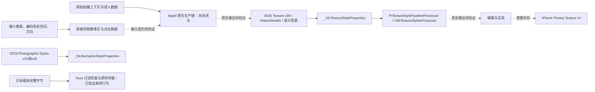

# XDRemux Texture Styles 原生适配调查 — 2026-10-19

## 当前可交付结果

**已实现并验证的是：拒绝伪造新纹理元数据，以及逐字节保留已有不透明载体。任意图像的 Apple 原生 Texture 元数据重计算、纹理风格识别、编辑渲染和 iPhone Photos 激活仍未证明。** 不把普通 Photographic Styles 的成功算作 Texture 成功。

本轮从 `XDRemux@f8fcf2067c506e87665e9ea113324db1a57d4cf7` 的 `research/texture-style` 出发，在独立目录和 `research/texture-native-20261019` 分支工作。只读审计 PSR `research/gpt-styles-20261019@5fef06eddaff8a8d2fd42c59e33612a5d576b088`；原生探针另放 PSR `research/xdremux-texture-native-20261019`，不修改该并行分支或 master。没有修改预加载 libheif 仓库、环境配置、secret、release；没有合并、发布、force push、向外部仓库发 PR 或评论。

`#65` 读取结果仍为 open，head `bc4d54753f18905dbe73f595a06a6eaf21aaa014`，未合并。`#85` 的 pull 和 issue API 均返回 404，不能把无法读取解释为已合并。本轮未引入 #65 的 HDR-first 修改。

## 先审计得到的证据图

完整节点、边、证据来源见 [evidence-graph.json](evidence-graph.json)。原仓库的 AGENTS 要求对 exact HEAD 做 completion gate，且不能以容器证明 Photos 交互编辑；本报告沿用该边界。



|对象|已有证据|不能推出的结论|
|---|---|---|
|`tag:apple.com,2023:photo:metadata:styles`|Rust 已有 v15 与诊断 v16 序列化，字段包含 key1、GTC、统计、光照图等。v16 的 `l=false` 仍在这一个 URI 内。|它不是独立的 2026 Texture 元数据，也不是纹理风格已激活。|
|`tag:apple.com,2026:photo:metadata:texture_styles`|旧探针的二进制 plist 有 Preset、CaptureType、CaptureMode、PortType、HardwareModel、TextureStylePeopleDataVersion、FilmGrainSeed。PSR 旧研究记录的 native 样本是 214B、Studio、seed65；XD 探针的 Standard/seed0 常量是 216B。|不能把常量长度、可解析或字段存在当作图像相关重计算。|
|Apple MakerNote tag84 (`0x0054`)|旧公开控制契约包含字符串键0–12，包含 Float32、整数和 Bool；旧 writer 对缺失 MakerNote 的输入生成 `Apple iOS`、PhotoIdentifier 与 tag84。|槽位的物理/算法含义、任意图像的计算方式尚未闭合；UUID 的确定性不提供 Apple 拍摄来源。|
|2026 `auxC` 语义资源|旧载体有 nose、skin v2、non-face skin、lips、teeth v2、person、glasses v2、eyebrows、tattoo、hands、ears、face skin 十二个声明。|一个 2019 skin matte 不能证明十二种语义；角色数量不是通用准入充分条件。|
|逐人上下文|已有 `_NUTextureStyleProperties` 消费入口、`personInputDataFromStillProperties:`、`personInputDataArrayFromDetectedFaces:` 等线索。PSR 旧记录在空 aux 字典下解析 persons0。|persons0 不证明图像没有人，也不能代替相机原始 face/instance ROI、pose、landmarks、instance mask、imageStats、眼部统计。|
|预设和调校表|PSR 静态清单记录5预设、285机型/port/模式组合，及 FilmGrain、Diffusion、Mattify 等符号和 EffectOrder。|不证明运行次序相对 GTM/LTM 的位置、内部 Linear/Log 域、真实滤波系数或可逆性。|

官方使用说明把 Texture 控件和 Photographic Styles 的调色控件区分，并对拍摄设备与编辑设备给出条件：[相机 Styles](https://support.apple.com/guide/iphone/use-photographic-styles-iph629d2cd37/ios)、[Photos 编辑](https://support.apple.com/en-lb/guide/iphone/iphb08064d57/ios)。这只能支持功能与设备范围，不公开底层生产算法。

## 正负对照与本轮实现

### 原缺陷确实复现

在独立的原始 base checkout 上运行同一反例：输入是纯程序构造的 HEIF item graph，primary/gain/matte 都是可识别的测试哨兵字节，**不是可解码照片，也不是 Apple 正样**。它满足旧 probe 的 style/skin/Exif/tmap 输入契约，但没有 Apple 拍摄信息。

旧 `augment_texture_style_heif` 仍生成 3655B 载体，新增 Texture URI、`HardwareModel=iPhone19,2`、`Apple iOS` MakerNote 和十二个别名。输入 SHA256 `42cb3c77691fb6985a7ff9af71ce0dc3f7958a311ccd3ce1ae290e96085cfa43`，旧输出 SHA256 `0ad11ab02be096811550113cbb40b4c74c57e5119bcbfb651211a442fd7c7ea4`。要求拒绝伪造的测试在原 base 上 exit101，明确失败于 `OLD_PROBE_FABRICATED_UNBACKED_TEXTURE_CARRIER`；这是有意的旧缺陷复现，不是新实现测试失败。

已知实机正样的历史结论保留为历史来源；本轮没有获准使用相机人像原件，未访问并行任务的临时 secret/加密运输。**没有复现真实相机纹理正样的 Photos 激活。** 新原生探针只重放已公开的元数据形状作为合成控制，不能替代真实原厂正样。

### 最小 Rust 方案

1. `inspect_texture_style_heif` 精确读取 `infe` 的 URI 字段，检查已有 Texture item 的本地位置、主图关联和引用。它记录元数据哈希与 `auxC` 类型声明，不解释 opaque plist 或认证蒙版含义。把 URI 文本放在 item name 中不会触发识别。
2. `preserve_texture_style_heif` 对已有本地载体返回完整原字节。因此压缩媒体、Gain Map、ICC、irot/imir、Exif、未知 box 与尾部都保持相同。越界 idat、悬空/错误引用、外部或未支持的位置失败；没有 Texture 数据时返回明确 generation unsupported。现有同名 `augment_...` 兼容入口遵循同一规则。
3. `--apple-styles` 使用实际提交到 semantic consumer 的 v15 数据，停止自动追加固定 Texture plist、MakerNote 与十二个角色别名。它继续是 Photographic Styles 路径；没有新增“纹理成功”的 CLI 标志。没有改动 LinearThumbnail 算法或 Apple Log 常数。
4. 研究用 example client 不覆盖已有输出。它不会把旧输入中已经存在的错误事实认证成真，也不会把 byte-identical 传输叫作新的原生生成。

现有引擎的 v16 序列化保留为诊断工具，并纠正注释：它只是2023 URI 的 v16 schema，不是完整2026 Texture producer。

离线验证覆盖27个 HEIF crate 测试（19单元、2已有失败关闭、6新增回归）、clippy，以及独立 Python 生成输入 → Rust example 写出 → Python 全字节比较。反例检查缺少 producer、idat 越界、错误/悬空引用、URI 名称混淆、JPEG/截断输入和输出保护。**这些样本没有可解码的图像，所以该轮只能证明传输和拒绝行为。** 不以自己的生成器和解析器证明 Apple 接受。

## 任意图像能重新计算什么

|类别|可行范围|本轮处理|
|---|---|---|
|像素尺寸、编码域、ICC、方向、是否有 Gain Map、文件与资源哈希|能从输入容器和正确配置的原生 decoder 观察。|Rust 传输保留；Apple ImageIO/CI 探针负责独立读回，结果待实际 runner。|
|新图像统计、新语义/人脸几何|原则上可以对正确方向和颜色域的解码图像重新检测，但属于新的分析上下文。|尚未证明满足完整 Texture producer 的统计/语义契约；不声称还原拍摄统计或标注。|
|Preset、强度、Grain 和新 seed|可作为明确的新编辑选择；seed 可新生成。|不能冒称原拍摄选择。当前安全 API 不生成这套数据。|
|HardwareModel、PortType、CaptureMode/Type|像素不携带可靠的相机机型、镜头 port 或具体捕获链事实。|缺失时保持缺失或 unsupported；若将来用作“调校目标”，必须与“原始来源”分开且验证原生契约。|
|TextureStylePeopleDataVersion、序列化版本|受具体原生 API、OS 及生产者版本控制。|公开 v3 控制和版本999负例只是诊断，不盲目把3或16当通用版本。|
|原始 RAW、原始预处理图、原始 LinearThumbnail、逐人 imageStats/眼部统计/instance masks|仅凭普通成片不能认证这些历史拍摄信息。|没有原始资源时不生成“原始信息”声明；已有派生 LinearThumbnail 只保留 Apple Log 路线。|

Apple 官方 HDR 文档区分 SDR、HDR 和 Gain Map，并要求编辑保持关联；保存可由正确的 SDR/HDR 对计算新的 Gain Map：[HDR API 说明](https://developer.apple.com/videos/play/wwdc2024/10177/)、[HEIF10 API](https://developer.apple.com/documentation/coreimage/cicontext/writeheif10representation%28of%3Ato%3Acolorspace%3Aoptions%3A%29)。这些 API 不负责 Texture 相机上下文的生成。本探针的 extended linear Display P3 是明确的**合成输入域**，不据此推断 Texture 内核内部域。

## 原生 Actions 与证据状态

仅 PSR 专用分支执行 Apple 调用。工作流限制到该分支和自己的两个路径，`contents:read`，artifact `retention-days:1`，不读取任何 secret 或仓库照片；不修改 Apple 方法、residency 策略、SIP 或权限。

首轮 probe source `6f420d751d0be1b2dc6f93ba7cccf62493affae9`：[run39282392876](https://github.com/21Z121Z1/Photographic_Style_Research/actions/runs/39282392876)，job118159072406，xcode-27。加入 macOS26 对照后的 source `4e6630d50eab3626254249ec5563af5ab6db8b93`：[run39283079303](https://github.com/21Z121Z1/Photographic_Style_Research/actions/runs/39283079303)，job118161349940（macos-26）、118161350462（xcode-27）。本记录创建时均为 queued，无真实 OS/SDK/build log 或 artifact；不能借用旧研究的27.0.1/26A434充当本轮环境。后续状态以 `evidence/` 和 `claims.json` 的实际读回为准。

原生探针执行 `_NUTextureStyleProperties.textureStylePropertiesFromImageMetadata:auxImageMetadata:error:`，记录标准/Studio合成控制、缺少 HardwareModel、版本999、空字典，保留原生 error 与类型。另记录 `PITextureStylePipelineProcessor` 默认字典与输入名、运行时方法/ABI，下一轮必须基于真实 inventory 追踪生产/渲染入口。

Rust 的 `texture_synthetic_inputs` 生成4个CC0图案，覆盖384×256、256×384、orientation1/6/8、SDR和HDR阶跃/亮点；清单 SHA256 `7967cb1ea86f962b2b43cc2fa9f4a9f61cc706498598a38e7652bc57d49f50ed`。Swift 仅负责 ImageIO JPEG/HEIC、PQ HEIF10、SDR/HDR 配对生成 Adaptive HDR 及原生读回。真实编码器不支持或输出缺少 Gain Map 时必须报告相应状态，不能把计划矩阵写成已通过。图案数学值不等于相机传感器线性数据。

|验证层|本轮能证明的内容|当前限制|
|---|---|---|
|字段可读|公开合成 plist 形状、旧结构字段的静态审计。|Apple 解析读回待 runner。|
|结构完整|限定的本地 opaque item graph 与全字节传输/拒绝已验证。|不是完整 HEVC 解码或所有 ISO 配置的认证。|
|原生消费者接受|尚未获得本轮真实结果。|queued；字段存在不算接受。|
|Apple API 明确识别 Texture|尚未获得本轮真实结果。|返回非空也只可证明该次消费，必须检查实际 Texture 类型与字段。|
|真实编辑/渲染参数有效|未验证。|需要同输入正负对照、非零参数变化和完整所需上下文。|
|iPhone Photos 纹理控件与持久编辑|未验证。|无已授权设备/UI/真实正样；macOS runner 的 shader 或 parser 不能替代。|

## 复现与交付

```bash
# 普通 Linux/macOS 离线回归；输出目录必须不存在。
python3 scripts/research/verify_texture_transport.py --out /tmp/texture-offline-new

# 可选：在另一个干净的 exact-base checkout 复现旧缺陷。
python3 scripts/research/verify_texture_transport.py --out /tmp/texture-baseline-new \
  --baseline-repo /path/to/clean-f8fcf206-checkout

# 研究样本只生成解析图案，不读用户照片。
cargo run --locked -p xdremux-heif --example texture_synthetic_inputs -- /tmp/new-analytic-inputs

# 仅保留已有 Texture carrier；NEW_OUTPUT 已存在会拒绝。
cargo run --locked -p xdremux-heif --example texture_transport -- INPUT.heic NEW_OUTPUT.heic
```

本容器通过官方 Rustup 在任务目录安装 Rust1.99.1，未修改 PATH profile。系统已有 libheif1.19.8，缺 pkg-config 开发元数据；本轮根据实际 `heif_get_version()` 在任务目录建立本地 `.pc` 与指向现有库的 symlink，未改系统或预加载 libheif。该动作只用于普通 Rust 构建。Linux 的 `apple_styles::tests` 过滤运行实际是0项，因为模块限macOS；**不把它写成 macOS 路径通过**。macOS 编译和功能验证单列。

机器可读结论见 [claims.json](claims.json)，直接执行项和硬阻塞见 [NATIVE_TODO.md](NATIVE_TODO.md)。验收只覆盖已有证据的离线行为，通用原生生成与真机激活不标完成。
